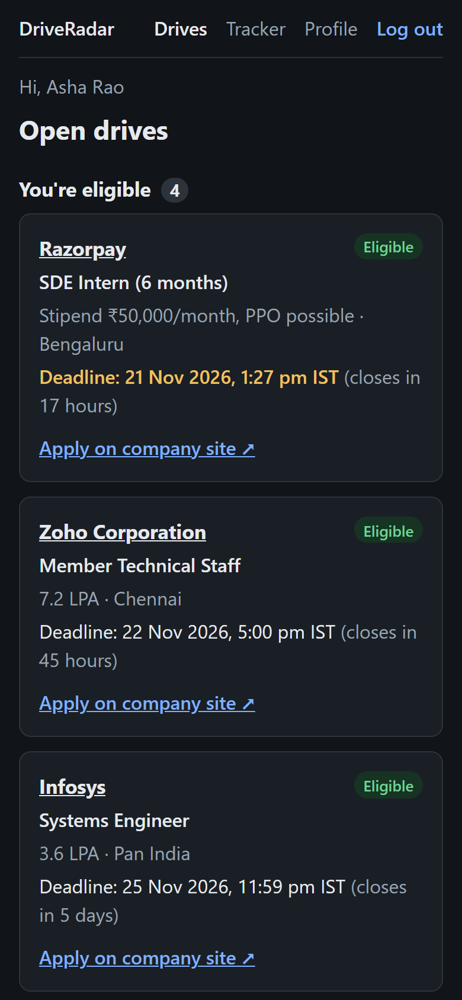
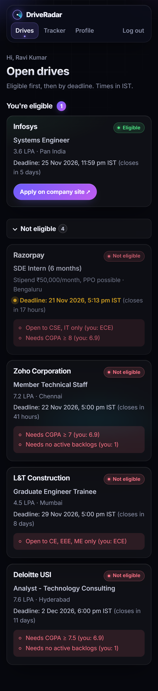
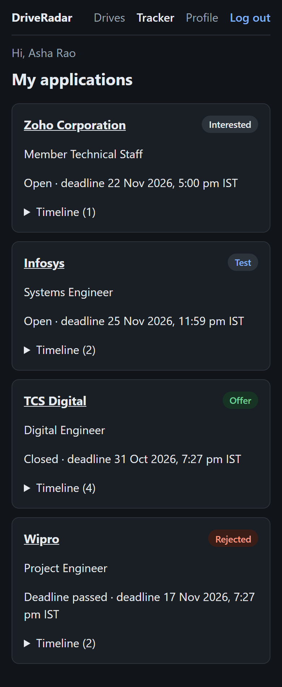
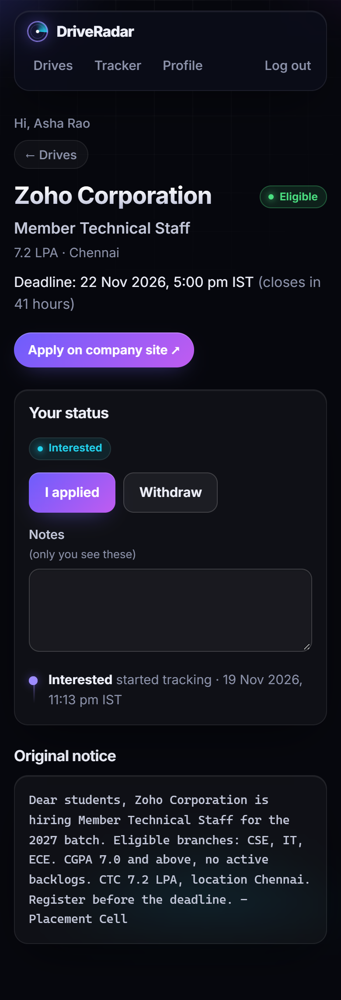
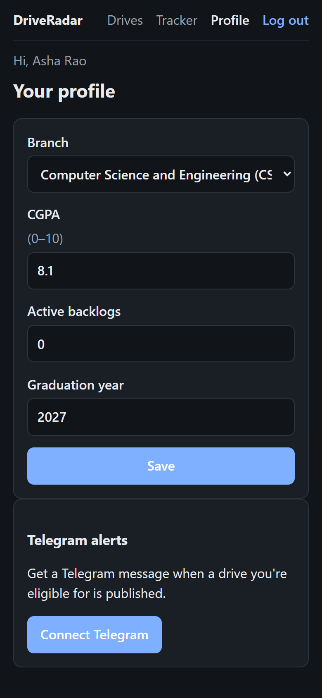
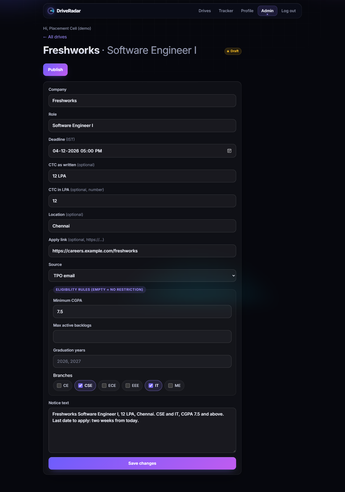
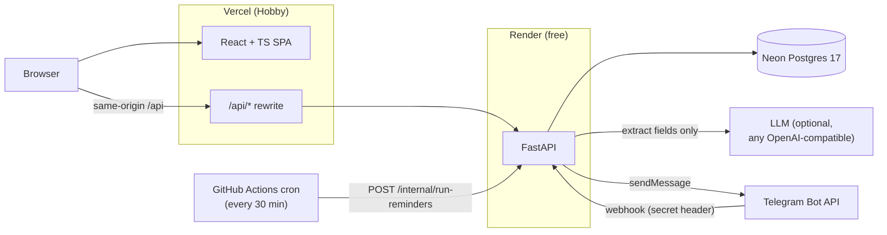

<p align="center">
  <a href="https://driveradar-mocha.vercel.app"></a>
</p>

<p align="center">
  <a href="https://github.com/nick10-05/driveradar/actions/workflows/ci.yml"></a>
  <a href="https://github.com/nick10-05/driveradar/actions/workflows/reminders.yml"></a>
  
  
  
  
  
</p>

<p align="center">
  <b><a href="https://driveradar-mocha.vercel.app">Live app</a></b> (invite-only for the batch) ·
  <a href="docs/DESIGN.md">Design doc</a>
</p>

**One feed of campus placement drives for my college batch**, filtered by each student's
eligibility, with AI-assisted notice extraction, an application tracker and Telegram
alerts before deadlines. Runs in production at **₹0/month**.

## ⚡ At a glance

| 🤖 AI with guardrails | 🎯 Eligibility engine | 🔔 Alerts that never double-send | 🧪 Production quality |
|---|---|---|---|
| The LLM only extracts fields, each backed by a quote from the notice; a human approves every drive | One pure, unit-tested function decides eligibility for both the feed and the alerts, with exact reasons | A GitHub Actions cron and a `UNIQUE` constraint give exactly-once Telegram reminders, 24 h and 3 h out | 99% backend coverage on real Postgres, typed API client generated from OpenAPI, strict CSP |

<p>
  
  
  
</p>

## 🎯 The problem

Placement notices reach a batch from four places: TPO emails, WhatsApp forwards, the
college portal and Telegram channels. Students miss deadlines, can't tell quickly which
drives they qualify for, and track applications in their heads.

## ✨ What it does

| For students | For the placement admin |
|---|---|
| A feed of open drives, **eligible first**; ineligible ones say exactly why ("Needs CGPA ≥ 7.5 (you: 6.9)") | Paste a notice → **AI extracts a draft** → review the flagged fields → publish |
| Drive page with the original notice, apply link and a status tracker (interested → applied → test → interview → offer) | Manual entry whenever the AI is off or fails |
| **Telegram alerts**: a new drive you're eligible for, then 24 h and 3 h before the deadline (skipped once you've applied) | Draft → published → closed, with every AI run logged for audit |
| Times shown in IST, stored in UTC | |

<p>
  
  
  
</p>

## 🧩 Architecture



- **Backend:** Python 3.13, FastAPI, Pydantic v2, SQLAlchemy 2 async + asyncpg, Alembic, httpx, structlog.
- **Frontend:** React 19 + TypeScript + Vite, types generated from the OpenAPI schema (openapi-typescript + openapi-fetch), TanStack Query, React Router.
- **Quality:** pytest against real PostgreSQL 17 in CI (99% coverage, ≥ 90% enforced on `app/services`), respx for HTTP mocks, ruff, mypy, vitest + Testing Library, pre-commit, Docker image smoke test, OpenAPI drift check.

Full design and decisions: [`docs/DESIGN.md`](docs/DESIGN.md).

## 🤖 The AI boundary

The LLM is a text-to-fields parser and nothing more:

```
notice text ─▶ Extractor ─▶ ExtractedNotice ─▶ normaliser ─▶ draft + per-field issues ─▶ admin review ─▶ publish
               (none |      (Pydantic, every    (evidence check,
                OpenAI-      field nullable,      IST→UTC, branch
                compatible)  evidence quotes)     aliases → codes)
```

- It **only extracts**. It never decides eligibility, never publishes, never sees student data and has no tools.
- **Evidence check (hallucination guard):** each key value (company, deadline, CTC, CGPA cutoff, branches, backlogs, batch years) must come with a quote that really appears in the notice, and numbers must appear inside that quote. Unbacked values are flagged "verify" next to the field for the admin; invalid values are set to null and flagged. Nothing is silently fixed.
- **Eligibility is a pure Python function** (`check_eligibility`), deterministic and unit-tested at the exact cutoffs. The feed and the alerts use the same function.
- **A human approves every drive.** The extraction endpoint only returns a draft.
- **Provider-independent and optional:** `LLM_PROVIDER=none` (the default) means manual entry. Any extractor failure falls back to manual entry. No vendor SDK, no LangChain.
- The notice is wrapped as data, not instructions. The golden set includes a prompt-injection notice.

## 📊 Measuring the AI

`evals/` holds a golden set of labelled notices (synthetic for now; real ones get anonymised
before they're added) and a runner that reports per-field accuracy, abstention, hallucination
rate, branch precision/recall, evidence-quote validity and latency:

```bash
uv run python -m evals.run    # by hand, never in CI (CI never calls a real LLM)
```

| Extractor | Stated fields extracted | Unstated fields invented | Invalid output | Notes |
|---|---|---|---|---|
| `none` (manual entry baseline) | 0% | 0% | 0% | [results](backend/evals/results/2026-11-19-none-none-v1.md) |

The baseline is the "nothing pre-filled" row, so any model run shows exactly what the AI adds. Plugging in a real model needs only an API key, with no code changes.

## 🔐 Security

- **Auth:** opaque DB sessions (SHA-256-hashed token) in a `__Host-session` cookie (HttpOnly, Secure, SameSite=Lax). No JWT, no refresh tokens. Argon2id passwords. Registration needs the batch invite code.
- **Split hosting without third-party cookies:** Vercel rewrites `/api/*` to Render, so the browser only talks to one origin. No CORS.
- **CSRF:** SameSite plus an `Origin` allow-list on every unsafe method. A missing Origin is rejected.
- **Rate limits:** login per email and per IP, registration per IP, extraction per admin.
- **Machine endpoints:** the Telegram webhook and the cron endpoint check secret headers in constant time, before the request body is parsed.
- **Secrets:** env vars only, fail-fast config, redacted logs. The bot token is kept out of the HTTP client logs.
- **Frontend:** strict CSP (no inline scripts or styles), HSTS, nosniff, Referrer-Policy.

## 🔔 Reliable alerts on free hosting

Free backends sleep, so an in-process scheduler can't be trusted:

- **External cron:** a GitHub Actions cron calls `POST /internal/run-reminders` every 30 minutes. The call itself wakes the backend.
- **Time windows:** the job selects deadlines *within* a window ("closes within the next 24 h"), never at an exact time, so a late run still works.
- **Exactly once:** `notifications` has `UNIQUE(student, drive, kind)`. The job inserts the row first and sends only if the insert went in. Retries and overlapping runs never send twice, so the cron can retry while Render wakes up.

## ⚖️ Trade-offs (what I chose not to build)

| Choice | Why | What changes at 10× scale |
|---|---|---|
| Paste notices, no scraping of WhatsApp/Gmail | Terms of service, fragile, and a human check keeps data correct | Email ingestion via a forwarding address |
| No Redis / Celery / queue | ₹0 and one process; background tasks for alerts, cron for reminders | A queue for extraction and alerts; Redis for rate limits |
| In-memory rate limits | Single instance | Shared store (Redis or Postgres) |
| Opaque sessions, not JWT | Instant logout and revocation, no key management | Same, plus a session cache |
| LLM optional, default `none` | No card anywhere; the app works without AI | A paid tier with higher limits |

## 💻 Run it locally

<details>
<summary><b>Backend, frontend, demo data and checks</b></summary>

Prereqs: Docker, Python 3.13 + [uv](https://docs.astral.sh/uv/), Node 24.

```bash
docker compose up -d db                          # Postgres 17
cd backend && cp .env.example .env               # then edit values
uv sync && uv run alembic upgrade head
uv run fastapi dev app/main.py                   # http://127.0.0.1:8000/docs
```

```bash
cd frontend && npm ci && npm run dev             # http://localhost:5173 (proxies /api)
```

Demo data (local databases only; the script refuses anything else):

```bash
cd backend && DEMO_PASSWORD='choose-a-long-one' uv run python -m app.scripts.seed_demo
```

Checks (the same ones CI runs):

```bash
cd backend && uv run ruff check . && uv run ruff format --check . && uv run mypy app evals && uv run pytest -q --cov
```

```bash
cd frontend && npm run check && npm run build
```

</details>

## 🚀 Deploy (all free, no card)

<details>
<summary><b>Neon, Render, Vercel, Telegram and the reminder cron</b></summary>

- **Neon:** Postgres. Use the *direct* host, not the pooler.
- **Render:** the backend, from [`render.yaml`](render.yaml). Health check on `/healthz`; it auto-deploys when CI passes.
- **Vercel:** the frontend, root directory `frontend`. [`vercel.json`](frontend/vercel.json) has the `/api` rewrite and the security headers.
- **Telegram:** create a bot with @BotFather, set the `TELEGRAM_*` vars on Render, then run `app.scripts.set_telegram_webhook`.
- **Reminders:** add a `CRON_SECRET` repository secret to GitHub.

</details>

## 🗺️ Roadmap

Next ideas (see DESIGN §12): company history, `.ics` deadline export, Telegram forward-to-draft, WhatsApp alerts.
